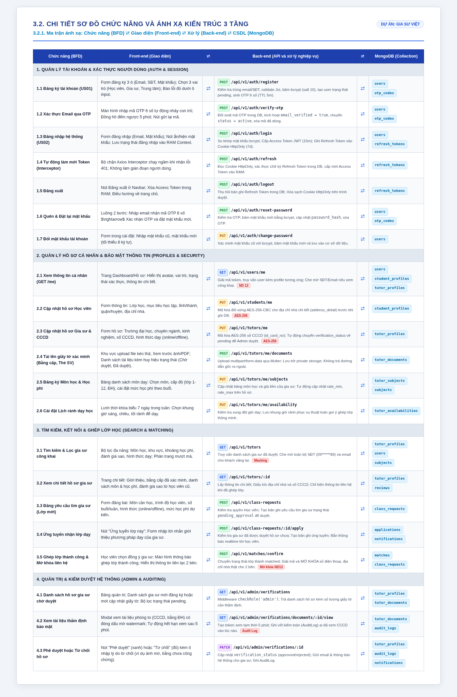

# 3.2. CHI TIẾT SƠ ĐỒ CHỨC NĂNG VÀ ÁNH XẠ KIẾN TRÚC 3 TẦNG
## DỰ ÁN: GIA SƯ VIỆT – KẾT NỐI GIA SƯ, NÂNG TẦM TRI THỨC

> **Mô hình ánh xạ 3 tầng chuẩn theo yêu cầu đồ án:**  
> **Chức năng (BFD) $\longleftrightarrow$ Front-end (Giao diện) $\longleftrightarrow$ Back-end (API & Xử lý nghiệp vụ) $\longleftrightarrow$ Cơ sở dữ liệu (MongoDB Collection)**

---

## 🖼️ BẢN ẢNH ĐỒ HỌA CHẤT LƯỢNG CAO (DÙNG ĐỂ BÁO CÁO / CHIẾU SLIDE / IN BÁO CÁO)

---

## 📊 BẢNG NỘI DUNG ĐẶC TẢ CHI TIẾT (DẠNG VĂN BẢN ĐỐI SOÁT)

| Chức năng (BFD) | Front-end (Giao diện) | ⇄ | Back-end (API và xử lý nghiệp vụ) | ⇄ | MongoDB (Collection) |
| :--- | :--- | :---: | :--- | :---: | :--- |
| **1. Quản lý tài khoản & Xác thực người dùng (Auth & Session)** | | | | | |
| **1.1 Đăng ký tài khoản (US01)** | Form đăng ký 3 ô (Email, SĐT, Mật khẩu); Chọn 3 vai trò (Học viên, Gia sư, Trung tâm); Báo lỗi đỏ dưới từng ô. | ⇄ | `POST /api/v1/auth/register` Kiểm tra trùng email/SĐT, validate Joi, băm mật khẩu bcrypt (salt 10), tạo user `status: 'pending'`, sinh OTP 6 số (TTL 5m). | ⇄ | `users` `otp_codes` |
| **1.2 Xác thực Email qua OTP** | Màn hình nhập mã OTP 6 số tự động nhảy con trỏ; Đồng hồ đếm ngược 5 phút; Nút gửi lại mã. | ⇄ | `POST /api/v1/auth/verify-otp` Đối soát OTP trong DB, kích hoạt `email_verified = true`, đổi `status = active`, xóa mã OTP đã dùng. | ⇄ | `users` `otp_codes` |
| **1.3 Đăng nhập hệ thống (US02)** | Form đăng nhập (Email, Mật khẩu); Nút ẩn/hiện mật khẩu; Lưu trạng thái đăng nhập vào RAM Context. | ⇄ | `POST /api/v1/auth/login` So khớp bcrypt; Cấp Access Token JWT (15m) vào response; Ghi Refresh Token vào Cookie `HttpOnly; SameSite=Strict` (7d). | ⇄ | `users` `refresh_tokens` |
| **1.4 Tự động làm mới Token (Interceptor)** | Bộ chặn Axios Interceptor chạy ngầm khi nhận lỗi 401; Không làm gián đoạn người dùng. | ⇄ | `POST /api/v1/auth/refresh` Đọc Cookie HttpOnly, xác thực chữ ký Refresh Token trong DB, cấp mới Access Token vào RAM. | ⇄ | `refresh_tokens` |
| **1.5 Đăng xuất** | Nút Đăng xuất ở Navbar; Xóa Access Token trong RAM; Điều hướng về trang chủ. | ⇄ | `POST /api/v1/auth/logout` Thu hồi bản ghi Refresh Token trong DB; Xóa sạch Cookie HttpOnly trên trình duyệt. | ⇄ | `refresh_tokens` |
| **1.6 Quên & Đặt lại mật khẩu** | Luồng 2 bước: Nhập email nhận OTP $\rightarrow$ Xác nhận OTP và đặt lại mật khẩu mới. | ⇄ | `POST /api/v1/auth/reset-password` Kiểm tra OTP, băm mật khẩu mới bằng bcrypt, cập nhật `password_hash`, xóa OTP. | ⇄ | `users` `otp_codes` |
| **1.7 Đổi mật khẩu tài khoản** | Form trong cài đặt: Nhập mật khẩu cũ, mật khẩu mới (tối thiểu 8 ký tự). | ⇄ | `PUT /api/v1/auth/change-password` Xác minh mật khẩu cũ với bcrypt, băm mật khẩu mới và lưu vào cơ sở dữ liệu. | ⇄ | `users` |
| **2. Quản lý Hồ sơ cá nhân & Bảo mật thông tin (Profiles & Security)** | | | | | |
| **2.1 Xem thông tin cá nhân (GET /me)** | Trang Dashboard/Hồ sơ: Hiển thị avatar, vai trò, trạng thái xác thực, thông tin chi tiết. | ⇄ | `GET /api/v1/users/me` Giải mã token, truy vấn user kèm profile tương ứng; Che mờ SĐT/Email nếu xem công khai (Nghị định 13). | ⇄ | `users` `student_profiles` `tutor_profiles` |
| **2.2 Cập nhật hồ sơ Học viên** | Form thông tin: Lớp học, mục tiêu học tập, tỉnh/thành, quận/huyện, địa chỉ nhà. | ⇄ | `PUT /api/v1/students/me` Mã hóa đối xứng AES-256-CBC cho địa chỉ nhà chi tiết (`address_detail`) trước khi ghi DB. | ⇄ | `student_profiles` |
| **2.3 Cập nhật hồ sơ Gia sư & CCCD** | Form hồ sơ: Trường đại học, chuyên ngành, kinh nghiệm, số CCCD, hình thức dạy (online/offline). | ⇄ | `PUT /api/v1/tutors/me` Mã hóa AES-256 số CCCD (`id_card_no`); Tự động chuyển `verification_status` về pending để Admin duyệt. | ⇄ | `tutor_profiles` |
| **2.4 Tải lên giấy tờ xác minh (Bằng cấp, Thẻ SV)** | Khu vực upload file kéo thả; Xem trước ảnh/PDF; Danh sách tài liệu kèm huy hiệu (Chờ duyệt, Đã duyệt). | ⇄ | `POST /api/v1/tutors/me/documents` Upload multipart/form-data qua Multer; Lưu trữ private storage; Không trả đường dẫn gốc ra ngoài. | ⇄ | `tutor_documents` |
| **2.5 Đăng ký Môn học & Học phí** | Bảng danh sách môn dạy: Chọn môn, cấp độ (lớp 1-12, ĐH), cài đặt mức học phí theo buổi. | ⇄ | `PUT /api/v1/tutors/me/subjects` Cập nhật bảng môn học và giá tiền của gia sư; Tự động cập nhật `rate_min`, `rate_max` trên hồ sơ. | ⇄ | `tutor_subjects` `subjects` |
| **2.6 Cài đặt Lịch rảnh dạy học** | Lưới thời khóa biểu 7 ngày trong tuần: Chọn khung giờ sáng, chiều, tối rảnh để dạy. | ⇄ | `PUT /api/v1/tutors/me/availability` Kiểm tra xung đột giờ dạy; Lưu khung giờ rảnh phục vụ thuật toán gợi ý ghép lớp thông minh. | ⇄ | `tutor_availabilities` |
| **3. Tìm kiếm, Kết nối & Ghép lớp học (Search & Matching)** | | | | | |
| **3.1 Tìm kiếm & Lọc gia sư công khai** | Bộ lọc đa năng: Môn học, khu vực, khoảng học phí, đánh giá sao, hình thức dạy; Phân trang mượt mà. | ⇄ | `GET /api/v1/tutors` Truy vấn danh sách gia sư đã duyệt; Che mờ toàn bộ SĐT (`09******89`) và email cho khách vãng lai. | ⇄ | `tutor_profiles` `users` `subjects` |
| **3.2 Xem chi tiết hồ sơ gia sư** | Trang chi tiết: Giới thiệu, bằng cấp đã xác minh, danh sách môn & học phí, đánh giá sao từ học viên cũ. | ⇄ | `GET /api/v1/tutors/:id` Lấy thông tin chi tiết; Giấu kín địa chỉ nhà và số CCCD; Chỉ hiện thông tin liên hệ khi đã ghép lớp. | ⇄ | `tutor_profiles` `reviews` |
| **3.3 Đăng yêu cầu tìm gia sư (Lớp mới)** | Form đăng bài: Môn cần học, trình độ học viên, số buổi/tuần, hình thức (online/offline), mức học phí dự kiến. | ⇄ | `POST /api/v1/class-requests` Kiểm tra quyền Học viên; Tạo bản ghi yêu cầu tìm gia sư trạng thái `pending_approval` để duyệt. | ⇄ | `class_requests` |
| **3.4 Ứng tuyển nhận lớp dạy** | Nút "Ứng tuyển lớp này"; Form nhập lời nhắn giới thiệu phương pháp dạy của gia sư. | ⇄ | `POST /api/v1/class-requests/:id/apply` Kiểm tra gia sư đã được duyệt hồ sơ chưa; Tạo bản ghi ứng tuyển; Bắn thông báo realtime tới học viên. | ⇄ | `applications` `notifications` |
| **3.5 Ghép lớp thành công & Mở khóa liên hệ** | Học viên chọn đồng ý gia sư; Màn hình thông báo ghép lớp thành công; Hiển thị thông tin liên lạc 2 bên. | ⇄ | `POST /api/v1/matches/confirm` Chuyển trạng thái lớp thành matched; Giải mã và MỞ KHÓA số điện thoại, địa chỉ nhà thật cho 2 bên. | ⇄ | `matches` `class_requests` |
| **4. Quản trị viên & Kiểm duyệt (Admin & Auditing)** | | | | | |
| **4.1 Danh sách hồ sơ gia sư chờ duyệt** | Bảng quản trị: Danh sách gia sư mới đăng ký hoặc mới cập nhật giấy tờ; Bộ lọc trạng thái pending. | ⇄ | `GET /api/v1/admin/verifications` Middleware `checkRole('admin')`; Trả danh sách hồ sơ kèm số lượng giấy tờ cần thẩm định. | ⇄ | `tutor_profiles` `tutor_documents` |
| **4.2 Xem tài liệu thẩm định bảo mật** | Modal xem tài liệu phóng to (CCCD, bằng ĐH) có đóng dấu mờ watermark; Tự động hết hạn xem sau 5 phút. | ⇄ | `GET /api/v1/admin/verifications/documents/:id/view` Tạo token xem tạm thời 5 phút; Ghi vết kiểm toán (AuditLog) ai đã xem CCCD vào lúc nào. | ⇄ | `tutor_documents` `audit_logs` |
| **4.3 Phê duyệt hoặc Từ chối hồ sơ** | Nút "Phê duyệt" (xanh) hoặc "Từ chối" (đỏ) kèm ô nhập lý do từ chối (ảnh mờ, bằng chưa công chứng). | ⇄ | `PATCH /api/v1/admin/verifications/:id` Cập nhật `verification_status` (approved/rejected); Gửi email & thông báo hệ thống cho gia sư; Ghi AuditLog. | ⇄ | `tutor_profiles` `audit_logs` `notifications` |
| **4.4 Quản lý & Khóa tài khoản vi phạm** | Bảng danh sách người dùng toàn hệ thống; Nút Khóa / Mở khóa tài khoản; Xem lịch sử đăng nhập sai. | ⇄ | `PATCH /api/v1/admin/users/:id/status` Cập nhật `status = locked/active`; Thu hồi token đăng nhập tức thì; Ghi AuditLog. | ⇄ | `users` `audit_logs` |
