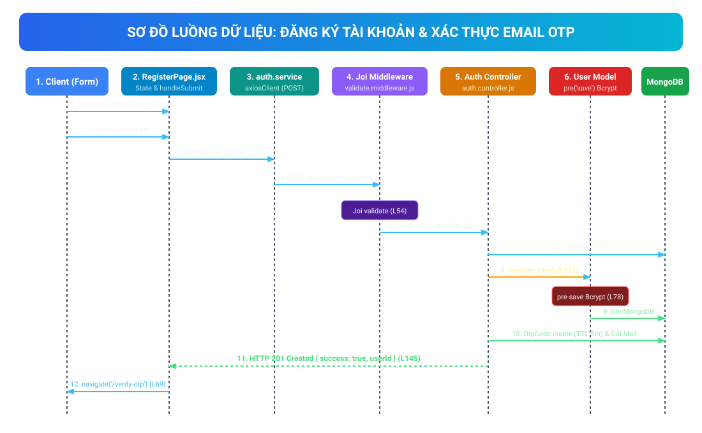
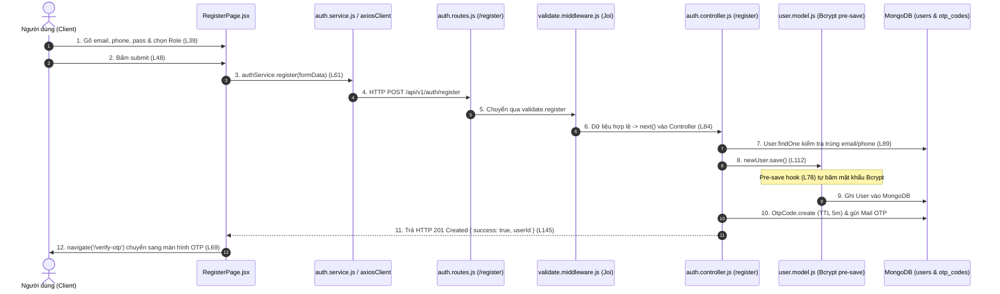
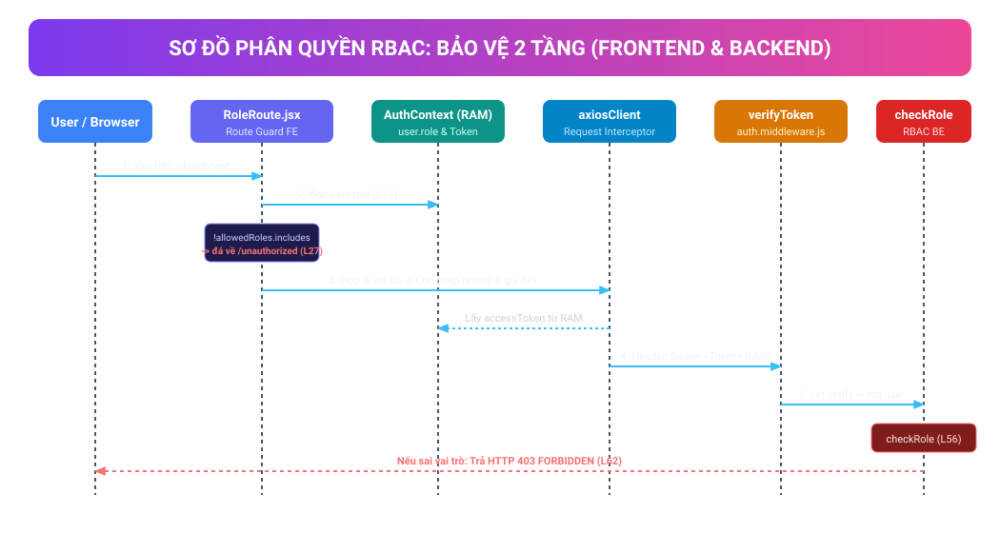
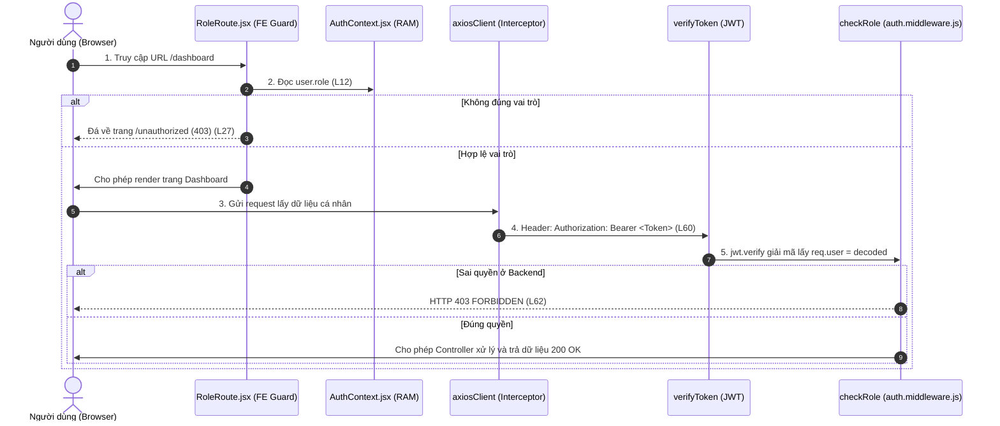
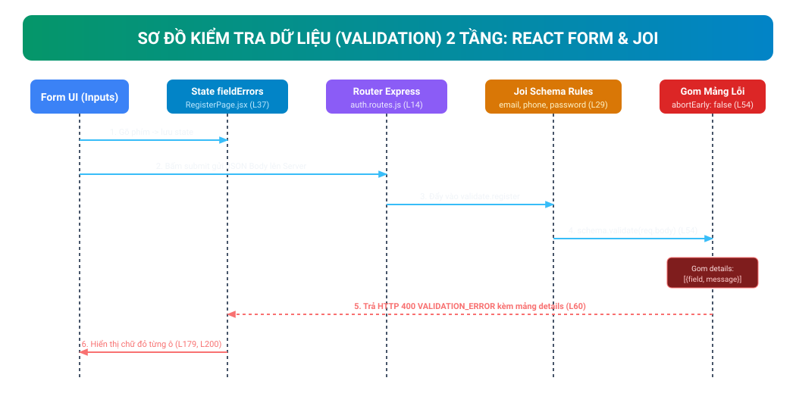
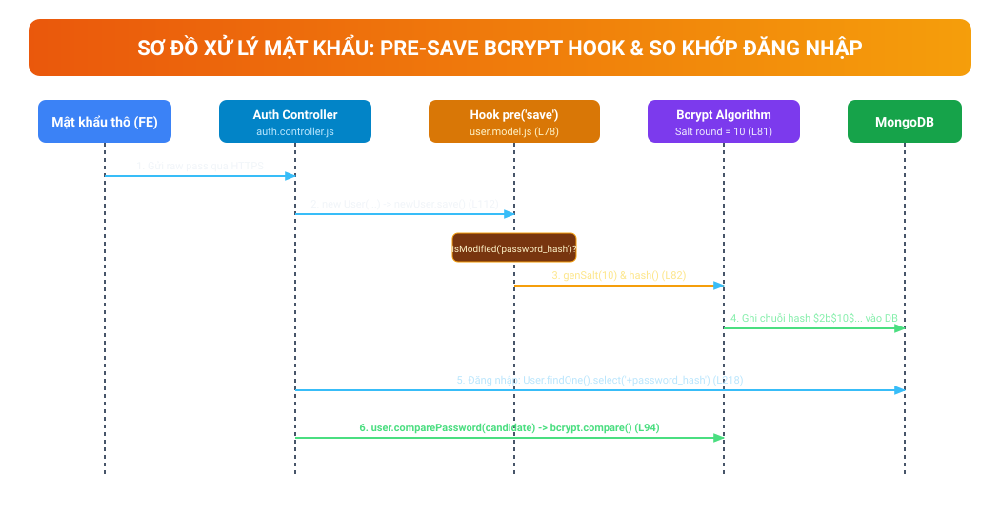

# CẨM NANG BÁO CÁO & TRẢ LỜI PHẢN BIỆN SPRINT 1 (DỰ ÁN GIA SƯ VIỆT)

> **Tài liệu phục vụ buổi báo cáo & trả lời vấn đáp trực tiếp trên mã nguồn.**  
> Mọi file, dòng code, sơ đồ luồng dữ liệu (Data Flow) và câu hỏi phản biện đã được đối chiếu chuẩn xác 100% với mã nguồn thực tế của dự án.  
> Sơ đồ được nhúng trực tiếp dạng ảnh Vector SVG (GitHub và mọi trình xem Markdown tự động hiển thị sắc nét 100%).

---

## 📌 PHẦN 1: BỘ 4 SƠ ĐỒ LUỒNG DỮ LIỆU TRỰC QUAN (ẢNH VECTOR SVG & MERMAID)

### 1.1. Sơ đồ Luồng Đăng ký (Register) & Xác thực OTP 6 số
Dữ liệu đi từ Form Frontend $\rightarrow$ State $\rightarrow$ Axios $\rightarrow$ Express Route $\rightarrow$ Joi Middleware $\rightarrow$ Controller $\rightarrow$ Bcrypt Hook băm mật khẩu $\rightarrow$ Ghi vào MongoDB $\rightarrow$ Lưu OTP TTL 5 phút $\rightarrow$ Trả mã 201 $\rightarrow$ FE tự chuyển sang màn hình OTP.



<details>
<summary>👉 Bấm vào đây để xem mã nguồn Mermaid của sơ đồ này</summary>


</details>

---

### 1.2. Sơ đồ Luồng Phân quyền theo vai trò (RBAC - Role-Based Access Control)
Phân quyền bảo vệ 2 tầng: Tầng Frontend dùng React Router Guard (`RoleRoute`) để điều hướng trải nghiệm; Tầng Backend dùng Middleware (`verifyToken` + `checkRole`) chặn đứng truy cập trái phép.



<details>
<summary>👉 Bấm vào đây để xem mã nguồn Mermaid của sơ đồ này</summary>


</details>

---

### 1.3. Sơ đồ Luồng Kiểm tra tính hợp lệ của dữ liệu (Validation Joi)
Quy trình gom mảng lỗi từ Backend Middleware trả về và ánh xạ chữ đỏ dưới từng ô input ở Frontend.



---

### 1.4. Sơ đồ Luồng Xử lý Mật khẩu (Pre-save Bcrypt Hook & So khớp)
Quy trình mật khẩu thô được băm bằng thuật toán Bcrypt với Salt round = 10 trước khi ghi vào MongoDB, cơ chế ẩn mật khẩu với `select: false`, và hàm `comparePassword`.



---

## 🎯 PHẦN 2: TRẢ LỜI ĐÚNG BỘ CÂU HỎI TRONG ẢNH CHO 3 CHỦ ĐỀ CHÍNH

---

### CHỦ ĐỀ 1: LOGIC PHÂN QUYỀN & ĐIỀU HƯỚNG (RBAC)
*(Câu hỏi thầy cô: "Chỉ ra trên code: chỗ em tạo router phân quyền ở đâu, vai trò lưu ở dòng nào, gọi API ra sao, server nhận ở đâu và dòng nào chặn quyền?")*

#### 1. Bên Frontend: Chỗ tạo chặn quyền (Guard) & định tuyến là đâu?
* **File Component Guard:** [`frontend/src/routes/RoleRoute.jsx`](frontend/src/routes/RoleRoute.jsx)
  * **Dòng 22 – 24:** Chặn chưa đăng nhập $\rightarrow$ đá về trang Login:
    ```javascript
    if (!isAuthenticated) return <Navigate to="/login" replace />;
    ```
  * **Dòng 26 – 28:** Chặn sai vai trò $\rightarrow$ đá sang trang không có quyền (403):
    ```javascript
    if (!allowedRoles.includes(user?.role)) return <Navigate to="/unauthorized" replace />;
    ```
* **File Cây định tuyến:** [`frontend/src/routes/AppRoutes.jsx`](frontend/src/routes/AppRoutes.jsx#L31-L38)
  * **Dòng 31 – 38:** Bọc các trang bắt buộc đăng nhập bằng `<ProtectedRoute>` hoặc `<RoleRoute allowedRoles={['admin']}>`.

#### 2. Dòng code nào lưu dữ liệu vai trò (Role)?
* **File:** [`frontend/src/contexts/AuthContext.jsx`](frontend/src/contexts/AuthContext.jsx#L18-L51)
  * **Dòng 18:** `const [user, setUser] = useState(null);` (Lưu thông tin user và `user.role` trong bộ nhớ RAM của React Context).
  * **Dòng 48:** Hàm `login()` nhận dữ liệu từ API đăng nhập rồi gọi `setUser(userData)` lưu vào RAM.

#### 3. Qua bên file API thì gửi quyền/Token ra sao?
* **File:** [`frontend/src/services/axiosClient.js`](frontend/src/services/axiosClient.js#L57-L67)
  * **Dòng 59 – 61 (Request Interceptor):** Tự động móc Token từ RAM gắn vào Header HTTP của mọi request:
    ```javascript
    config.headers.Authorization = `Bearer ${memoryAccessToken}`;
    ```

#### 4. Qua bên Server: API nhận ở đâu và DÒNG NÀO CHẶN QUYỀN?
* **File Route:** [`backend/src/routes/user.routes.js`](backend/src/routes/user.routes.js#L12)
  * **Dòng 12:** `router.get('/me', verifyToken, userController.getProfile);`
* **File Middleware chặn quyền:** [`backend/src/middlewares/auth.middleware.js`](backend/src/middlewares/auth.middleware.js)
  * **Dòng 32 – 45 (`verifyToken`):** Dùng `jwt.verify` giải mã Token từ Header, lấy `{ id, role }` gán vào `req.user`.
  * **Dòng 56 – 69 (DÒNG CHẶN QUYỀN `checkRole`):**
    ```javascript
    checkRole: (...allowedRoles) => (req, res, next) => {
      if (!req.user || !allowedRoles.includes(req.user.role)) {
        return ApiResponse.error(res, 'bạn không có quyền truy cập...', 'FORBIDDEN', null, 403);
      }
      next(); // Đúng vai trò mới cho phép vào Controller
    }
    ```

---

### CHỦ ĐỀ 2: BẢO MẬT FORM & CHỐNG HACK API (VALIDATION JOI)
*(Câu hỏi thầy cô: "Chỉ ra trên code: chỗ em tạo form là đâu, lưu dữ liệu nhập vào dòng nào, file API gọi ra sao, server nhận và validate chỗ nào, dòng nào gom mảng lỗi trả về?")*

#### 1. Bên Frontend: Chỗ tạo Form & Hiển thị chữ đỏ báo lỗi ở đâu?
* **File:** [`frontend/src/pages/auth/RegisterPage.jsx`](frontend/src/pages/auth/RegisterPage.jsx)
  * **Dòng 160 – 235:** Thẻ `<form onSubmit={handleSubmit}>` chứa các ô input:
    * Ô Email: **dòng 168**
    * Ô Số điện thoại: **dòng 189**
    * Ô Mật khẩu: **dòng 210**
  * **Dòng 179, 200, 222:** Các dòng hiển thị chữ báo lỗi đỏ ngay dưới từng ô:
    ```jsx
    {fieldErrors.email && <p className="text-rose-500 text-xs mt-1.5">{fieldErrors.email}</p>}
    ```

#### 2. Dòng code nào lưu dữ liệu đã nhập vào?
* **File:** [`frontend/src/pages/auth/RegisterPage.jsx`](frontend/src/pages/auth/RegisterPage.jsx#L28-L46)
  * **Dòng 28 – 32:** State lưu dữ liệu form: `const [formData, setFormData] = useState({ email: '', phone: '', password: '' });`
  * **Dòng 37:** State lưu danh sách lỗi: `const [fieldErrors, setFieldErrors] = useState({});`
  * **Dòng 39 – 46:** Hàm `handleChange` nhận phím gõ để lưu vào `formData` và xóa lỗi cũ của trường đó.

#### 3. Qua bên file API thì gọi dữ liệu ra sao?
* **File:** [`frontend/src/services/auth.service.js`](frontend/src/services/auth.service.js#L12-L14)
  * **Dòng 12 – 14:**
    ```javascript
    register: (data) => {
      return axiosClient.post('/auth/register', data);
    }
    ```
    *(Dữ liệu được gói thành JSON, gửi qua phương thức HTTP POST).*

#### 4. Qua bên Server: API nhận ở đâu và DÒNG NÀO VALIDATE BẮT LỖI?
* **File Route:** [`backend/src/routes/auth.routes.js`](backend/src/routes/auth.routes.js#L14)
  * **Dòng 14:** `router.post('/register', authRateLimiter, validate.register, authController.register);`
* **File Middleware:** [`backend/src/middlewares/validate.middleware.js`](backend/src/middlewares/validate.middleware.js#L28-L62)
  * **Dòng 29 – 52:** Định nghĩa Schema Joi (Email bắt buộc, SĐT regex 10 số `0[3|5|7|8|9]...`, Mật khẩu $\ge$ 8 ký tự).
  * **DÒNG 54 (DÒNG THỰC THI KIỂM TRA):**
    ```javascript
    const { error, value } = schema.validate(req.body, { abortEarly: false, stripUnknown: true });
    ```
  * **DÒNG 56 – 61 (DÒNG GOM MẢNG LỖI VÀ TRẢ VỀ 400):**
    ```javascript
    if (error) {
      const details = error.details.map((detail) => ({
        field: detail.path.join('.'),
        message: detail.message.replace(/['"]/g, ''),
      }));
      return ApiResponse.error(res, 'Thông tin đăng ký chưa hợp lệ', 'VALIDATION_ERROR', details, 400);
    }
    ```

#### 5. Frontend nhận mảng lỗi map vào từng ô ở đâu?
* **File:** [`frontend/src/pages/auth/RegisterPage.jsx`](frontend/src/pages/auth/RegisterPage.jsx#L73-L78)
  * Khối `catch (err)`: Lấy mảng `err.error.details` gán vào state `fieldErrors` để từng ô input hiện cảnh báo đỏ tương ứng.

---

### CHỦ ĐỀ 3: CƠ SỞ DỮ LIỆU & XỬ LÝ MẬT KHẨU (MODEL USER & BCRYPT)
*(Câu hỏi thầy cô: "Chỉ ra trên code: mật khẩu nhập ở đâu, truyền đi ra sao, dòng nào băm Bcrypt, dòng nào lưu DB, dòng nào so khớp mật khẩu và dòng nào xóa mềm?")*

#### 1. Bên Frontend: Chỗ nhập mật khẩu là đâu?
* **File:** [`frontend/src/pages/auth/LoginPage.jsx`](frontend/src/pages/auth/LoginPage.jsx#L125-L135) hoặc `RegisterPage.jsx`:
  * Ô input nhập mật khẩu thô: `<input type={showPassword ? 'text' : 'password'} ... value={formData.password} onChange={handleChange} />`.

#### 2. Qua file API gửi mật khẩu đi đâu?
* **File:** [`frontend/src/services/auth.service.js`](frontend/src/services/auth.service.js#L33-L35)
  * **Dòng 33 – 35:** `login: (data) => axiosClient.post('/auth/login', data);`
  * Mật khẩu dạng thô được truyền an toàn qua kết nối mã hóa HTTPS lên Server.

#### 3. Server nhận ở Controller nào?
* **File:** [`backend/src/controllers/auth.controller.js`](backend/src/controllers/auth.controller.js)
  * Khi **Đăng ký (Dòng 103 – 112):** Gán pass thô vào `new User({ password_hash: password })`, rồi gọi `await newUser.save();`.
  * Khi **Đăng nhập (Dòng 218):** 
    `const user = await User.findOne({ email }).select('+password_hash');`
    *(Phải có `.select('+password_hash')` mới lấy được chuỗi băm ra, vì bình thường trường này bị ẩn bằng `select: false`)*.

#### 4. DÒNG NÀO TỰ ĐỘNG BĂM MẬT KHẨU BCRYPT TRONG MODEL?
* **File Model:** [`backend/src/models/user.model.js`](backend/src/models/user.model.js#L78-L87)
  * **DÒNG 78 – 87 (PRE-SAVE HOOK):**
    ```javascript
    userSchema.pre('save', async function (next) {
      if (!this.isModified('password_hash')) return next(); // dòng 79: chống băm đúp
      const salt = await bcrypt.genSalt(10); // dòng 81: sinh salt 10 vòng
      this.password_hash = await bcrypt.hash(this.password_hash, salt); // dòng 82: băm bcrypt
      next();
    });
    ```

#### 5. DÒNG NÀO SO KHỚP MẬT KHẨU KHI ĐĂNG NHẬP?
* **File Model:** [`backend/src/models/user.model.js`](backend/src/models/user.model.js#L94-L96)
  * **Dòng 94 – 96:**
    ```javascript
    userSchema.methods.comparePassword = async function (candidatePassword) {
      return await bcrypt.compare(candidatePassword, this.password_hash);
    };
    ```
* **File Controller:** [`backend/src/controllers/auth.controller.js`](backend/src/controllers/auth.controller.js#L226)
  * **Dòng 226:** Gọi `const isMatch = await user.comparePassword(password);` nếu sai trả về mã 401.

#### 6. DÒNG NÀO ĐỊNH NGHĨA XÓA MỀM (SOFT DELETE)?
* **File Model:** [`backend/src/models/user.model.js`](backend/src/models/user.model.js#L63-L68)
  * **Dòng 63 – 68:**
    ```javascript
    deleted_at: {
      type: Date,
      default: null,
      index: true,
    },
    ```
  * Khi xóa tài khoản: chỉ cập nhật `deleted_at = new Date()`, không dùng lệnh `deleteOne()` để bảo toàn toàn bộ dữ liệu lịch sử dạy học và hợp đồng.

---

## ❓ PHẦN 3: TỔNG HỢP CÁC CÂU HỎI THẦY CÔ CHẮC CHẮN SẼ HỎI XOÁY & CÂU TRẢ LỜI "ĂN ĐIỂM"

* **Hỏi:** *Tại sao Frontend đã dùng HTML5 required và regex rồi, mà Backend vẫn phải dùng Joi kiểm tra lại lần nữa?*
  * **Đáp:** Tuân thủ nguyên tắc cốt lõi của an ninh mạng: **Zero-Trust (Không bao giờ tin tưởng dữ liệu từ máy trạm)**. Bất kỳ ai cũng có thể tắt JavaScript trên trình duyệt, sửa mã HTML bằng Inspect Element, hoặc dùng trực tiếp các công cụ như Postman, cURL để bắn dữ liệu độc hại thẳng vào API mà không hề đi qua giao diện Frontend. Do đó, tầng Middleware Joi tại Backend là chốt chặn bắt buộc và tối thượng.

* **Hỏi:** *Tại sao lại dùng đồng thời 2 loại token: Access Token (15 phút) và Refresh Token (7 ngày)? Sao không làm 1 token 7 ngày cho đơn giản?*
  * **Đáp:** Đây là bài toán cân bằng giữa **Trải nghiệm người dùng** và **An toàn thông tin**:
    * Nếu chỉ dùng 1 token 7 ngày và lưu trong `localStorage`: Khi hacker đánh cắp được token (qua lỗ hổng XSS), chúng có thể toàn quyền sử dụng tài khoản của nạn nhân suốt 7 ngày mà máy chủ không có cách nào thu hồi tức thì (do JWT là stateless).
    * Giải pháp của nhóm: Access Token sống siêu ngắn (15 phút) lưu trong RAM. Refresh Token (7 ngày) lưu trong Cookie `HttpOnly` và được lưu trong bảng `refresh_tokens` ở Database. Nếu nghi ngờ tài khoản bị lộ, Admin hoặc người dùng chỉ cần bấm Đăng xuất, Server thu hồi bản ghi Refresh Token trong DB là phiên làm việc bị vô hiệu hóa ngay lập tức.

* **Hỏi:** *Trong file `user.model.js`, tại sao hook `pre('save')` phải có dòng `if (!this.isModified('password_hash')) return next();`?*
  * **Đáp:** Dòng này để tránh lỗi **Băm kép (Double Hashing)**. Khi người dùng chỉ sửa số điện thoại hoặc cập nhật họ tên (mà không đổi mật khẩu), nếu không có dòng này, Mongoose vẫn sẽ lấy chuỗi băm cũ đem đi băm Bcrypt thêm một lần nữa. Khi đó mật khẩu trong DB bị sai lệch hoàn toàn và người dùng vĩnh viễn không thể đăng nhập lại được.

* **Hỏi:** *Tại sao trường `password_hash` lại khai báo `{ select: false }`?*
  * **Đáp:** Để ngăn chặn lỗi lộ lọt dữ liệu (Data Leakage). Khi gọi các câu lệnh thông thường như `User.find()` hay `User.findById()`, Mongoose sẽ tự động lược bỏ trường mật khẩu. Nhờ vậy lập trình viên không bao giờ vô tình đẩy chuỗi băm mật khẩu ra API. Chỉ duy nhất ở hàm `login` cần so khớp mật khẩu ta mới dùng lệnh tường minh `.select('+password_hash')`.

* **Hỏi:** *Mã OTP tự hủy sau 5 phút như thế nào? Em có viết hàm setInterval quét database không?*
  * **Đáp:** Nhóm không dùng `setInterval` hay Cron job vì gây quá tải CPU và chậm database. Nhóm sử dụng tính năng **TTL Index (Time-To-Live)** của MongoDB tại file [`security.model.js`](backend/src/models/security.model.js#L42):
    ```javascript
    expires_at: { type: Date, required: true, index: { expires: 0 } }
    ```
    Chính tiến trình nền của MongoDB engine sẽ tự động quét và xóa sạch bản ghi khi thời gian thực tế chạm mốc `expires_at`.

---

## 🏆 KỊCH BẢN MỞ ĐẦU TỰ TIN KHI ĐỨNG LÊN BÁO CÁO (NÓI TRONG 1 PHÚT)

> *"Kính thưa quý thầy cô, trong Sprint 1 này nhóm em tập trung hoàn thiện nền tảng kiến trúc vững chắc cho hệ thống Gia Sư Việt.  
> * **Về Backend:** Nhóm đã chuẩn hóa kiến trúc 3 lớp với đầy đủ 16 Mongoose Models, xây dựng hệ thống API RESTful bảo mật cao với cơ chế băm mật khẩu Bcrypt, mã hóa AES-256 cho dữ liệu nhạy cảm theo Nghị định 13, và cơ chế xác thực kép Access Token trong RAM kết hợp Refresh Token trong HttpOnly Cookie.  
> * **Về Frontend:** Nhóm đã xây dựng hoàn chỉnh giao diện trên nền React + Vite + TailwindCSS, thiết lập hệ thống Route Guard phân quyền cho 4 vai trò, và cài đặt Axios Interceptor tự động làm mới phiên đăng nhập ngầm.  
> Toàn bộ luồng đăng ký, gửi nhận mã OTP 6 số tự hủy qua MongoDB TTL Index và đăng nhập phân quyền đã được kiểm thử tự động 100%. Em xin phép mở trực tiếp mã nguồn để trình bày chi tiết luồng dữ liệu của hệ thống ạ!"*
