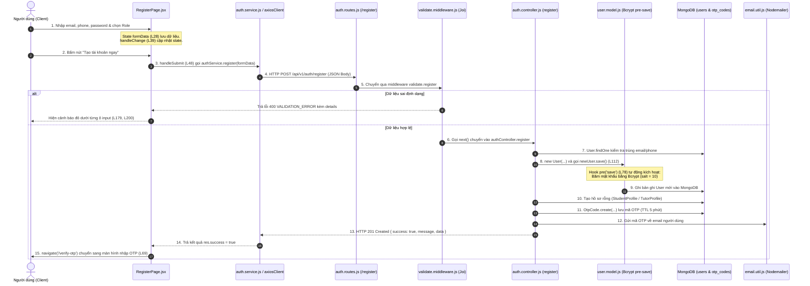
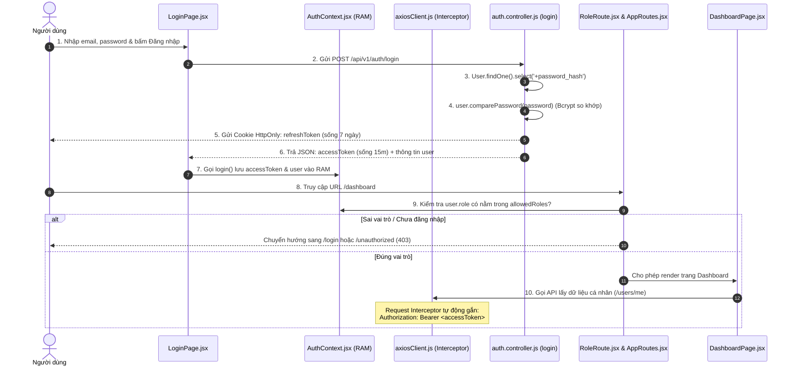

# CẨM NANG BÁO CÁO & TRẢ LỜI PHẢN BIỆN SPRINT 1 (DỰ ÁN GIA SƯ VIỆT)

> **Tài liệu phục vụ buổi báo cáo & trả lời vấn đáp trực tiếp trên mã nguồn.**  
> Mọi file, dòng code, sơ đồ luồng dữ liệu (Data Flow) và câu hỏi phản biện đã được đối chiếu chuẩn xác 100% với mã nguồn thực tế của dự án.

---

## 📌 PHẦN 1: SƠ ĐỒ LUỒNG DỮ LIỆU TỔNG THỂ (DATA FLOW DIAGRAM)

### 1.1. Sơ đồ tuần tự chức năng Đăng ký (Register) & Xác thực OTP
Luồng đi của dữ liệu từ khi người dùng nhập form ở trình duyệt cho đến khi ghi vào MongoDB và gửi email:



---

### 1.2. Sơ đồ tuần tự chức năng Đăng nhập & Phân quyền (Login & RoleRoute)



---

## 🎯 PHẦN 2: BẢNG TRUY VẾT MÃ NGUỒN TỪNG CHỨC NĂNG (CODE TRACING)

### Câu hỏi 1: "Chỉ ra luồng của chức năng ĐĂNG KÝ (Register) đi qua những đâu?"

| Bước | Thành phần | File cần mở trong VS Code | Dòng code cụ thể & Nội dung cần chỉ tay |
| :---: | :--- | :--- | :--- |
| **1** | **State lưu dữ liệu** | `frontend/src/pages/auth/RegisterPage.jsx` | **Dòng 28 – 32:** `const [formData, setFormData] = useState({ email: '', phone: '', password: '' });`<br/>**Dòng 39 – 46:** Hàm `handleChange` lưu phím bấm vào `formData`. |
| **2** | **Chỗ tạo Form** | `frontend/src/pages/auth/RegisterPage.jsx` | **Dòng 160 – 235:** Thẻ `<form onSubmit={handleSubmit}>`<br/>* Ô email: **dòng 168**<br/>* Ô SĐT: **dòng 189**<br/>* Ô mật khẩu: **dòng 210** |
| **3** | **Bấm Submit** | `frontend/src/pages/auth/RegisterPage.jsx` | **Dòng 48:** Hàm `handleSubmit`<br/>**Dòng 61 – 67:** Gọi `authService.register(formData)`. |
| **4** | **File gọi API** | `frontend/src/services/auth.service.js` | **Dòng 12 – 14:** `register: (data) => axiosClient.post('/auth/register', data)` bắn HTTP POST tới `http://localhost:5000/api/v1/auth/register`. |
| **5** | **Server tiếp nhận** | `backend/src/routes/auth.routes.js` | **Dòng 14:** `router.post('/register', authRateLimiter, validate.register, authController.register);` |
| **6** | **Chỗ Validate** | `backend/src/middlewares/validate.middleware.js` | **Dòng 29 – 52:** Định nghĩa luật Joi (email, phone 10 số, password >= 8 ký tự).<br/>**Dòng 54:** `schema.validate(req.body)` thực thi kiểm tra. |
| **7** | **Nhận tại Controller** | `backend/src/controllers/auth.controller.js` | **Dòng 86:** `const { email, phone, password, role } = req.body;`<br/>**Dòng 89 – 100:** `User.findOne` kiểm tra trùng email/SĐT. |
| **8** | **DÒNG LƯU VÀO DB** | `backend/src/controllers/auth.controller.js` | **DÒNG 112:** `await newUser.save();`<br/>*(Lưu bản ghi vào collection `users` của MongoDB)*. |
| **9** | **Chỗ Băm Bcrypt** | `backend/src/models/user.model.js` | **Dòng 78 – 87:** Hook `userSchema.pre('save')` tự động kích hoạt băm mật khẩu bằng Bcrypt trước khi ghi vào đĩa cứng. |
| **10** | **Sinh & Lưu OTP** | `backend/src/controllers/auth.controller.js` | **Dòng 134 – 140:** `await OtpCode.create({...})` lưu mã 6 số (tự hủy sau 5 phút qua MongoDB TTL Index). |
| **11** | **Server Trả về FE** | `backend/src/controllers/auth.controller.js` | **Dòng 145 – 153:** `ApiResponse.success(res, '...', { userId }, 201)`. |
| **12** | **FE Chuyển trang** | `frontend/src/pages/auth/RegisterPage.jsx` | **Dòng 69 – 71:** `if (res.success) navigate('/verify-otp?email=...')` chuyển sang trang nhập mã OTP. |

---

### Câu hỏi 2: "Chỉ ra luồng XÁC THỰC OTP (Verify OTP) hoạt động như thế nào?"

| Bước | Thành phần | File cần mở trong VS Code | Dòng code cụ thể |
| :---: | :--- | :--- | :--- |
| **1** | **Giao diện 6 ô số** | `frontend/src/pages/auth/VerifyOtpPage.jsx` | **Dòng 24:** `const [otp, setOtp] = useState(new Array(6).fill(''));`<br/>**Dòng 41 – 60:** Tự động nhảy con trỏ chuột sang ô tiếp theo khi gõ. |
| **2** | **Gửi mã xác thực** | `frontend/src/pages/auth/VerifyOtpPage.jsx` | **Dòng 70 – 95:** Bấm xác nhận $\rightarrow$ gọi `authService.verifyOtp({ email, otp })`. |
| **3** | **Route tiếp nhận** | `backend/src/routes/auth.routes.js` | **Dòng 17:** `router.post('/verify-otp', authRateLimiter, validate.verifyOtp, authController.verifyOtp);` |
| **4** | **Controller đối soát** | `backend/src/controllers/auth.controller.js` | **Dòng 164 – 195:**<br/>* Tìm mã trong DB: `OtpCode.findOne({ email, otp_hash: otp })`<br/>* Kích hoạt user: `User.updateOne({ email }, { email_verified: true, status: 'active' })`<br/>* Xóa mã đã dùng: `OtpCode.deleteOne({ _id: otpRecord._id })` |
| **5** | **Điều hướng FE** | `frontend/src/pages/auth/VerifyOtpPage.jsx` | **Dòng 83:** Nhận thành công $\rightarrow$ `navigate('/login')` chuyển sang đăng nhập. |

---

### Câu hỏi 3: "Chỉ ra luồng ĐĂNG NHẬP & PHÂN QUYỀN (Login & RoleRoute) ở đâu?"

| Bước | Thành phần | File cần mở trong VS Code | Dòng code cụ thể |
| :---: | :--- | :--- | :--- |
| **1** | **Form Đăng nhập** | `frontend/src/pages/auth/LoginPage.jsx` | **Dòng 24 – 27:** State lưu `email`, `password`.<br/>**Dòng 100 – 150:** Form JSX với 2 ô input. |
| **2** | **Controller Login** | `backend/src/controllers/auth.controller.js` | **Dòng 218:** `User.findOne({ email }).select('+password_hash')`<br/>**Dòng 226:** `await user.comparePassword(password)` (so khớp Bcrypt). |
| **3** | **Cấp Token & Cookie** | `backend/src/controllers/auth.controller.js` | **Dòng 238:** `setRefreshTokenCookie(res, refreshToken)` (ghi cookie HttpOnly 7 ngày).<br/>**Dòng 240 – 255:** Trả về `{ accessToken, user }` (sống 15 phút). |
| **4** | **Lưu RAM ở FE** | `frontend/src/contexts/AuthContext.jsx` | **Dòng 42 – 55:** Hàm `login()` lưu `user` và `accessToken` trong bộ nhớ RAM (`useState`). |
| **5** | **Chặn Route FE** | `frontend/src/routes/RoleRoute.jsx` | **Dòng 22 – 24:** Nếu chưa login $\rightarrow$ `<Navigate to="/login" />`<br/>**Dòng 26 – 28:** Nếu `!allowedRoles.includes(user?.role)` $\rightarrow$ `<Navigate to="/unauthorized" />`. |
| **6** | **Chốt chặn Route BE** | `backend/src/middlewares/auth.middleware.js` | **Dòng 32 – 45:** `verifyToken` giải mã Bearer Token lấy `{ id, role }`.<br/>**Dòng 56 – 69:** `checkRole` nếu sai vai trò trả về `403 Forbidden`. |

---

## ❓ PHẦN 3: TỔNG HỢP CÁC CÂU HỎI THẦY CÔ CHẮC CHẮN SẼ HỎI XOÁY & CÂU TRẢ LỜI "ĂN ĐIỂM"

### 1. Về Luồng Dữ liệu & Kiến trúc (Architecture)
* **Hỏi:** *Tại sao em chia cấu trúc 3 lớp: Router, Middleware, Controller mà không viết tất cả vào 1 file cho nhanh?*
  * **Đáp:** Đây là kiến trúc chuẩn **Separation of Concerns (SoC)** trong công nghiệp phần mềm:
    * `Routes`: Chỉ chịu trách nhiệm định tuyến URL.
    * `Middlewares`: Kiểm tra điều kiện tiên quyết (Rate limit, Validate dữ liệu, Xác thực JWT).
    * `Controllers`: Chỉ thuần túy xử lý logic nghiệp vụ và tương tác Model.
    * Cách tách này giúp code dễ bảo trì, dễ viết kiểm thử tự động (Unit Test), và nhiều thành viên trong nhóm có thể làm việc song song mà không bị conflict code.

* **Hỏi:** *Dữ liệu gửi từ Frontend lên Backend dưới định dạng gì, và cấu trúc phản hồi của nhóm em quy định ra sao?*
  * **Đáp:** Dữ liệu gửi đi dưới dạng JSON qua HTTP Header `Content-Type: application/json`. Phản hồi trả về được chuẩn hóa qua file [`response.util.js`](backend/src/utils/response.util.js):
    * Thành công: `{ success: true, message: "...", data: { ... } }` (mã HTTP 200, 201).
    * Thất bại: `{ success: false, error: { code: "...", message: "...", details: [ ... ] } }` (mã HTTP 400, 401, 403, 404, 500).

---

### 2. Về Bảo mật & Xác thực (Security & Auth)
* **Hỏi:** *Tại sao lại dùng đồng thời 2 loại token: Access Token (15 phút) và Refresh Token (7 ngày)? Sao không làm 1 token 7 ngày cho đơn giản?*
  * **Đáp:** Đây là bài toán cân bằng giữa **Trải nghiệm người dùng** và **An toàn thông tin**:
    * Nếu chỉ dùng 1 token 7 ngày và lưu trong `localStorage`: Khi hacker đánh cắp được token (qua lỗ hổng XSS), chúng có thể toàn quyền sử dụng tài khoản của nạn nhân suốt 7 ngày mà máy chủ không có cách nào thu hồi tức thì (do JWT là stateless).
    * Giải pháp của nhóm: Access Token sống siêu ngắn (15 phút) lưu trong RAM. Refresh Token (7 ngày) lưu trong Cookie `HttpOnly` và được lưu trong bảng `refresh_tokens` ở Database. Nếu nghi ngờ tài khoản bị lộ, Admin hoặc người dùng chỉ cần bấm Đăng xuất, Server thu hồi bản ghi Refresh Token trong DB là phiên làm việc bị vô hiệu hóa ngay lập tức.

* **Hỏi:** *Nếu người dùng đang làm bài hoặc đang dùng web mà Access Token 15 phút hết hạn thì sao? Người dùng có bị văng ra trang Login không?*
  * **Đáp:** Không bao giờ bị văng! File [`axiosClient.js`](frontend/src/services/axiosClient.js#L70-L135) có cài đặt **Response Interceptor**. Khi nhận mã lỗi `401 Unauthorized`, nó sẽ tạm dừng request đó lại, tự động gọi ngầm API `POST /api/v1/auth/refresh` bằng Cookie. Server cấp lại Access Token mới, Axios cập nhật token vào RAM rồi tự động gửi lại request cũ. Người dùng không hề nhận thấy sự gián đoạn.

* **Hỏi:** *Mã OTP tự hủy sau 5 phút như thế nào? Em có viết hàm setInterval quét database không?*
  * **Đáp:** Nhóm không dùng `setInterval` hay Cron job vì gây quá tải CPU và chậm database. Nhóm sử dụng tính năng **TTL Index (Time-To-Live)** của MongoDB tại file [`security.model.js`](backend/src/models/security.model.js#L42):
    ```javascript
    expires_at: { type: Date, required: true, index: { expires: 0 } }
    ```
    Chính tiến trình nền của MongoDB engine sẽ tự động quét và xóa sạch bản ghi khi thời gian thực tế chạm mốc `expires_at`.

---

### 3. Về Cơ sở dữ liệu & Model Mongoose
* **Hỏi:** *Trong file `user.model.js`, tại sao hook `pre('save')` phải có dòng `if (!this.isModified('password_hash')) return next();`?*
  * **Đáp:** Dòng này để tránh lỗi **Băm kép (Double Hashing)**. Khi người dùng chỉ sửa số điện thoại hoặc cập nhật họ tên (mà không đổi mật khẩu), nếu không có dòng này, Mongoose vẫn sẽ lấy chuỗi băm cũ đem đi băm Bcrypt thêm một lần nữa. Khi đó mật khẩu trong DB bị sai lệch hoàn toàn và người dùng vĩnh viễn không thể đăng nhập lại được.

* **Hỏi:** *Tại sao trường `password_hash` lại khai báo `{ select: false }`?*
  * **Đáp:** Để ngăn chặn lỗi lộ lọt dữ liệu (Data Leakage). Khi gọi các câu lệnh thông thường như `User.find()` hay `User.findById()`, Mongoose sẽ tự động lược bỏ trường mật khẩu. Nhờ vậy lập trình viên không bao giờ vô tình đẩy chuỗi băm mật khẩu ra API. Chỉ duy nhất ở hàm `login` cần so khớp mật khẩu ta mới dùng lệnh tường minh `.select('+password_hash')`.

* **Hỏi:** *Xóa mềm (Soft Delete) qua trường `deleted_at` có lợi ích gì hơn xóa cứng (`deleteOne`)?*
  * **Đáp:** Trong hệ sinh thái kết nối gia sư, tài khoản gắn liền với hợp đồng, đánh giá, khiếu nại và lịch sử dạy học. Nếu dùng xóa cứng, toàn bộ dữ liệu liên quan sẽ bị lỗi toàn vẹn tham chiếu (Foreign Key mồ côi). Xóa mềm bằng cách đánh dấu thời gian `deleted_at: new Date()` giúp ẩn tài khoản khỏi hệ thống nhưng vẫn bảo lưu dữ liệu để đối soát và xử lý tranh chấp khi cần.

---

### 4. Về Kiểm tra tính hợp lệ (Validation)
* **Hỏi:** *Tại sao Frontend đã dùng HTML5 required và kiểm tra regex rồi, mà Backend vẫn phải dùng Joi kiểm tra lại lần nữa?*
  * **Đáp:** Tuân thủ nguyên tắc cốt lõi của an ninh mạng: **Zero-Trust (Không bao giờ tin tưởng dữ liệu từ máy trạm)**. Bất kỳ ai cũng có thể tắt JavaScript trên trình duyệt, sửa mã HTML bằng Inspect Element, hoặc dùng trực tiếp các công cụ như Postman, cURL để bắn dữ liệu độc hại thẳng vào API mà không hề đi qua giao diện Frontend. Do đó, tầng Middleware Joi tại Backend là chốt chặn bắt buộc và tối thượng.

---

## 🏆 KỊCH BẢN MỞ ĐẦU TỰ TIN KHI ĐỨNG LÊN BÁO CÁO (NÓI TRONG 1 PHÚT)

> *"Kính thưa quý thầy cô, trong Sprint 1 này nhóm em tập trung hoàn thiện nền tảng kiến trúc vững chắc cho hệ thống Gia Sư Việt.  
> * **Về Backend:** Nhóm đã chuẩn hóa kiến trúc 3 lớp với đầy đủ 16 Mongoose Models, xây dựng hệ thống API RESTful bảo mật cao với cơ chế băm mật khẩu Bcrypt, mã hóa AES-256 cho dữ liệu nhạy cảm theo Nghị định 13, và cơ chế xác thực kép Access Token trong RAM kết hợp Refresh Token trong HttpOnly Cookie.  
> * **Về Frontend:** Nhóm đã xây dựng hoàn chỉnh giao diện trên nền React + Vite + TailwindCSS, thiết lập hệ thống Route Guard phân quyền cho 4 vai trò, và cài đặt Axios Interceptor tự động làm mới phiên đăng nhập ngầm.  
> Toàn bộ luồng đăng ký, gửi nhận mã OTP 6 số tự hủy qua MongoDB TTL Index và đăng nhập phân quyền đã được kiểm thử tự động 100%. Em xin phép mở trực tiếp mã nguồn để trình bày chi tiết luồng dữ liệu của hệ thống ạ!"*
