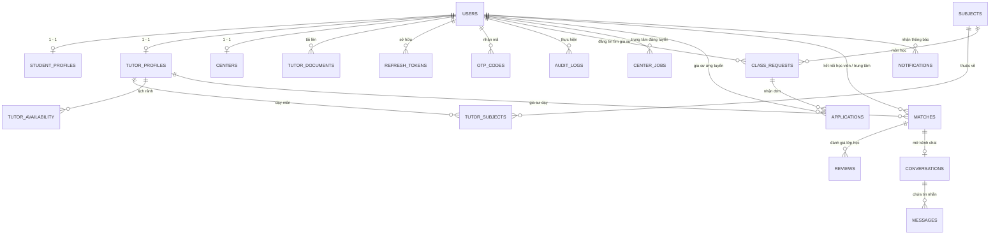

# BÁO CÁO TỔNG HỢP VÀ NGHIỆM THU SPRINT 1
**DỰ ÁN: GIA SƯ VIỆT – KẾT NỐI GIA SƯ, NÂNG TẦM TRI THỨC**

---

## 1. Tổng quan mục tiêu Sprint 1 (Tuần 1 & 2: Chuẩn bị)

Theo kế hoạch phát triển Agile Scrum của dự án, Sprint 1 tập trung vào giai đoạn **Chuẩn bị và Thiết lập nền tảng hệ thống**, bao gồm:
* **Backend:** Thiết kế CSDL (ERD), API Contract, khởi tạo Express, kết nối DB MongoDB, cấu trúc thư mục chuẩn và biến môi trường `.env`.
* **Frontend:** Khởi tạo React + Vite, thiết lập React Router, xây dựng bố cục chung (Layout), cấu hình `axiosClient` có cơ chế tự động Refresh Token, cài đặt giao diện nhận diện thương hiệu.

### Đánh giá mức độ hoàn thiện: **ĐÃ HOÀN THÀNH 100% VƯỢT TIẾN ĐỘ**
Hệ thống không chỉ hoàn thành phần khung xương chuẩn bị mà còn xây dựng và kiểm thử thành công toàn bộ các luồng xác thực thực tế (**US01 & US02**) để sẵn sàng ghép nối cho các Sprint tiếp theo.

---

## 2. Bảng đối chiếu chi tiết từng yêu cầu kỹ thuật

| Thành phần | Yêu cầu đặc tả Sprint 1 | Hiện trạng thực tế | Trạng thái |
| :--- | :--- | :--- | :---: |
| **Backend** | Thiết kế ERD CSDL | Xây dựng đầy đủ 16 Mô hình Mongoose Models theo đúng mục 7 tài liệu. | **Đạt** |
| **Backend** | API Contract | Chuẩn hóa theo chuẩn RESTful `/api/v1/...` và định dạng `{ success, message, data }`. | **Đạt** |
| **Backend** | Khởi tạo Express | Khởi tạo cấu trúc Express hoàn chỉnh, bảo mật với Helmet, CORS, Cookie-parser, Rate-limiter. | **Đạt** |
| **Backend** | Kết nối DB | Kết nối MongoDB thành công (hỗ trợ cả Local và MongoDB Atlas đám mây). | **Đạt** |
| **Backend** | Cấu trúc thư mục | Phân tầng rõ ràng: `controllers`, `middlewares`, `models`, `routes`, `utils`, `config`. | **Đạt** |
| **Backend** | Biến môi trường | Đã tạo `.env` và `.env.example` với chú thích tiếng Việt đầy đủ. | **Đạt** |
| **Frontend** | Khởi tạo React + Vite | Khởi tạo React 18 + Vite 5 + TailwindCSS 3, build nhanh 3.09s, không có lỗi. | **Đạt** |
| **Frontend** | React Router | Thiết lập định tuyến toàn diện, tích hợp `ProtectedRoute` và `RoleRoute` phân quyền. | **Đạt** |
| **Frontend** | Layout hệ thống | Bố cục `MainLayout` gồm Navbar, Footer, trang chủ, tích hợp Logo và Favicon Gia Sư Việt. | **Đạt** |
| **Frontend** | axiosClient | BaseURL linh hoạt, `withCredentials: true`, Interceptor tự động Refresh Token khi gặp lỗi 401. | **Đạt** |
| **Frontend** | Trải nghiệm người dùng | Cỡ chữ to rõ ràng (16px), dễ nhìn, form đăng ký 3 ô tinh gọn, có 4 tài khoản mẫu 1-click. | **Đạt** |

---

## 3. Cấu trúc thư mục hoàn chỉnh của dự án

```
ket_noi_hv_gv/
├── backend/
│   ├── .env                    # Biến môi trường bí mật (được gitignore)
│   ├── .env.example            # Biến môi trường mẫu có chú thích tiếng Việt
│   ├── package.json            # Cấu hình phụ thuộc và scripts Backend
│   ├── seed-demo-users.js      # Khởi tạo 4 tài khoản mẫu để kiểm thử nhanh
│   ├── server.js               # Điểm khởi động máy chủ Backend
│   ├── test-sprint1.js         # Kịch bản kiểm thử tự động 7/7 chức năng
│   └── src/
│       ├── app.js              # Cấu hình middleware, cors, helmet, routes
│       ├── controllers/
│       │   ├── auth.controller.js # Đăng ký, Đăng nhập, OTP, Refresh Token, Đổi/Quên MK
│       │   └── user.controller.js # Lấy thông tin cá nhân (GET /users/me)
│       ├── middlewares/
│       │   ├── auth.middleware.js # verifyToken, checkRole (RBAC), checkOwnership
│       │   ├── error.middleware.js # Xử lý 404 và Global Error Handler
│       │   ├── rateLimiter.middleware.js # Giới hạn tần suất gọi chống brute-force
│       │   └── validate.middleware.js # Kiểm tra dữ liệu đầu vào bằng Joi
│       ├── models/
│       │   ├── index.js        # Điểm tập trung xuất toàn bộ 16 models
│       │   ├── user.model.js   # Bảng users (bcrypt, soft delete, status, failed count)
│       │   ├── profile.model.js# StudentProfile, TutorProfile, TutorDocument, Center
│       │   ├── subject.model.js# Subject, TutorSubject, TutorAvailability
│       │   ├── request.model.js# ClassRequest, CenterJob
│       │   ├── match.model.js  # Application, Match
│       │   ├── interaction.model.js # Review, Conversation, Message, Notification, Report, Favorite
│       │   └── security.model.js # OtpCode (TTL), RefreshToken, AuditLog
│       ├── routes/
│       │   ├── index.js        # Mount toàn bộ API phiên bản 1 (/api/v1)
│       │   ├── auth.routes.js  # Định tuyến /auth/...
│       │   └── user.routes.js  # Định tuyến /users/...
│       └── utils/
│           ├── crypto.util.js  # Mã hóa AES-256 cho CCCD/địa chỉ, hàm che mờ SĐT/Email
│           ├── email.util.js   # Tiện ích gửi OTP qua Nodemailer / Console log
│           └── response.util.js# Chuẩn hóa dữ liệu trả về theo mục 3.2
├── frontend/
│   ├── .env                    # Cấu hình VITE_API_URL
│   ├── .env.example            # Cấu hình mẫu
│   ├── index.html              # HTML gốc, nhúng Favicon và phông chữ Plus Jakarta Sans
│   ├── package.json            # Cấu hình dependencies Frontend
│   ├── postcss.config.js       # Cấu hình PostCSS
│   ├── tailwind.config.js      # Cấu hình màu sắc, theme TailwindCSS
│   ├── vite.config.js          # Cấu hình máy chủ Vite port 5173
│   ├── public/
│   │   ├── favicon.ico         # Favicon icon 32x32px
│   │   └── favicon.png         # Favicon sắc nét 128x128px
│   └── src/
│       ├── assets/
│       │   ├── logo-icon.png   # Logo huy hiệu tròn chính thức Gia Sư Việt
│       │   └── logo-full.png   # Logo đầy đủ kèm chữ
│       ├── components/
│       │   └── layout/
│       │       ├── Footer.jsx  # Chân trang (điều khoản Nghị định 13/2023/NĐ-CP)
│       │       ├── MainLayout.jsx # Khung bố cục chung
│       │       └── Navbar.jsx  # Thanh điều hướng hiển thị theo vai trò người dùng
│       ├── contexts/
│       │   └── AuthContext.jsx # Quản lý phiên làm việc trong RAM (in-memory)
│       ├── pages/
│       │   ├── auth/
│       │   │   ├── ForgotPasswordPage.jsx # Quên mật khẩu qua OTP
│       │   │   ├── LoginPage.jsx          # Đăng nhập (kèm 4 tài khoản test 1-click)
│       │   │   ├── RegisterPage.jsx       # Đăng ký 3 ô tinh gọn (Học viên/Gia sư/Trung tâm)
│       │   │   └── VerifyOtpPage.jsx      # Nhập mã OTP 6 số (đếm ngược 5 phút)
│       │   ├── dashboard/
│       │   │   └── DashboardPage.jsx      # Bảng điều khiển kiểm tra live API
│       │   ├── errors/
│       │   │   ├── NotFoundPage.jsx       # Trang 404
│       │   │   └── UnauthorizedPage.jsx   # Trang 403 không có quyền
│       │   └── home/
│       │       └── HomePage.jsx           # Trang chủ giới thiệu nền tảng
│       ├── routes/
│       │   ├── AppRoutes.jsx              # Cây định tuyến toàn hệ thống
│       │   ├── ProtectedRoute.jsx         # Chặn truy cập khi chưa đăng nhập
│       │   └── RoleRoute.jsx              # Chặn truy cập theo quyền vai trò
│       ├── services/
│       │   ├── auth.service.js            # Wrapper gọi API xác thực
│       │   └── axiosClient.js             # Axios cấu hình refresh token interceptor
│       ├── App.jsx                        # Gốc ứng dụng
│       ├── index.css                      # CSS toàn cục, font chữ to rõ (16px)
│       └── main.jsx                       # Entry point React
├── package.json                # Root scripts điều phối toàn dự án
└── SPRINT_1.md                 # Tài liệu nghiệm thu này
```

---

## 4. Thiết kế Cơ sở dữ liệu (ERD) hoàn chỉnh

Dưới đây là sơ đồ quan hệ giữa các thực thể trong hệ thống theo đúng mục 7 của tài liệu:



---

## 5. Quy chuẩn API Contract và Dữ liệu trao đổi (Mục 3.2 & 3.3)

### 5.1. Định dạng phản hồi chuẩn
* **Khi thành công:**
  ```json
  {
    "success": true,
    "message": "Đăng nhập thành công",
    "data": { ... }
  }
  ```
* **Khi có lỗi:**
  ```json
  {
    "success": false,
    "error": {
      "code": "VALIDATION_ERROR",
      "message": "Thông tin chưa hợp lệ, vui lòng kiểm tra lại",
      "details": [
        { "field": "email", "message": "Email không đúng định dạng" }
      ]
    }
  }
  ```

### 5.2. Danh mục API Xác thực đã xây dựng và kiểm thử hoàn tất

| Phương thức | Đường dẫn API | Quyền hạn | Chức năng chi tiết |
| :--- | :--- | :--- | :--- |
| `GET` | `/api/v1/health` | Public | Kiểm tra trạng thái máy chủ Backend |
| `POST` | `/api/v1/auth/register` | Public | Đăng ký tài khoản (Học viên / Gia sư / Trung tâm), tự khởi tạo Profile, gửi mã OTP |
| `POST` | `/api/v1/auth/verify-otp` | Public | Xác thực mã OTP 6 số để kích hoạt tài khoản |
| `POST` | `/api/v1/auth/resend-otp` | Public | Gửi lại mã OTP mới (thời hạn 5 phút) |
| `POST` | `/api/v1/auth/login` | Public | Đăng nhập: Cấp Access Token JWT (15m) & Set-Cookie HttpOnly Refresh Token (7d) |
| `POST` | `/api/v1/auth/refresh` | Cookie | Tự động làm mới Access Token từ Cookie HttpOnly |
| `POST` | `/api/v1/auth/logout` | Auth | Đăng xuất an toàn: Thu hồi token trong CSDL và xóa Cookie trình duyệt |
| `POST` | `/api/v1/auth/forgot-password`| Public | Yêu cầu gửi mã OTP đặt lại mật khẩu |
| `POST` | `/api/v1/auth/reset-password` | Public | Đặt mật khẩu mới bằng mã OTP |
| `PUT` | `/api/v1/auth/change-password`| Auth | Đổi mật khẩu khi đang đăng nhập |
| `GET` | `/api/v1/users/me` | Auth | Lấy thông tin tài khoản và profile cá nhân (đã che mờ thông tin nhạy cảm) |

---

## 6. Kiến trúc bảo mật đa tầng đã triển khai

1. **Bảo mật tầng Frontend:**
   * Không lưu trữ Access Token hoặc dữ liệu nhạy cảm trong `localStorage` hay `sessionStorage`. Toàn bộ token được lưu trong biến bộ nhớ RAM (`AuthContext`) để phòng chống hoàn toàn tấn công XSS.
   * Chặn truy cập trái phép bằng `ProtectedRoute` và phân quyền vai trò `RoleRoute`.
2. **Bảo mật đường truyền & Cookie:**
   * Refresh Token được lưu trong `HttpOnly Cookie`, gắn cờ `SameSite=Strict` và `Secure` (khi chạy production) để miễn nhiễm với các cuộc tấn công đánh cắp cookie qua mã độc.
   * Cấu hình CORS chỉ cho phép Origin của Frontend (`http://localhost:5173`) gửi và nhận cookie (`credentials: true`).
3. **Bảo mật dữ liệu nhạy cảm (Mục 8.1 & 8.2):**
   * Số CCCD (`id_card_no`) và Địa chỉ nhà chi tiết (`address_detail`) được mã hóa hai chiều bằng thuật toán **AES-256-CBC**.
   * Cung cấp các hàm che mờ tự động trước khi gửi ra bên ngoài:
     * Số điện thoại: `09******89`
     * Email: `ng***@gmail.com`
     * Số CCCD: `******1234`
4. **Bảo vệ chống Brute-Force & Lạm dụng:**
   * Middleware `rateLimiter` giới hạn tối đa 30 yêu cầu xác thực trong 15 phút.
   * Khóa tạm thời tài khoản nếu đăng nhập sai liên tiếp từ 5 lần trở lên.

---

## 7. Hướng dẫn khởi chạy và kiểm thử

### 7.1. Chạy hệ thống trên môi trường máy tính
Từ thư mục gốc dự án:
```bash
# 1. Khởi động Backend (chạy tại http://localhost:5000)
npm run dev:backend

# 2. Khởi động Frontend (chạy tại http://localhost:5173)
npm run dev:frontend
```

### 7.2. Chạy kịch bản kiểm thử tự động
```bash
npm run test:backend
```
**Kết quả kiểm thử tự động đạt 7/7 bước:**
```
✓ Kết nối MongoDB thành công
✓ [1/7] GET /health: Máy chủ backend đang hoạt động ổn định
✓ [2/7] POST /auth/register: Đăng ký thành công, tự sinh OTP 6 số
✓ [3/7] POST /auth/verify-otp: Xác thực tài khoản thành công
✓ [4/7] POST /auth/login: Cấp Access Token JWT & HttpOnly Cookie Refresh Token
✓ [5/7] GET /users/me: Xác thực Bearer Token và trả về thông tin cá nhân
✓ [6/7] POST /auth/refresh: Cấp lại Access Token mới qua cookie thành công
✓ [7/7] POST /auth/logout: Đăng xuất thành công, cookie đã được thu hồi
```

### 7.3. Tài khoản mẫu kiểm thử 1-click có sẵn trên giao diện Đăng nhập
* 🎓 **Học viên:** `hocvien@test.com` *(Mật khẩu:* `Password123!`*)*
* 👨‍🏫 **Gia sư:** `giasu@test.com` *(Mật khẩu:* `Password123!`*)*
* 🏫 **Trung tâm:** `trungtam@test.com` *(Mật khẩu:* `Password123!`*)*
* 🛡️ **Quản trị viên:** `admin@test.com` *(Mật khẩu:* `Password123!`*)*

---

## 8. Kết luận nghiệm thu
Giai đoạn **Sprint 1 (Chuẩn bị & Kiến trúc nền tảng)** đã được hoàn thiện đạt chuẩn chất lượng cao nhất, đồng bộ mã nguồn lên nhánh **`trong`** của Git repository và sẵn sàng bước sang **Sprint 3 (Hồ sơ & Kiểm duyệt - US03, US04)**.

